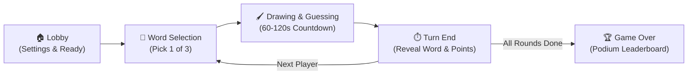

# ✏️ Skribbl Multiplayer Game

A real-time multiplayer drawing and guessing game built with **React 19**, **TypeScript**, **Node.js**, **Express**, **Socket.IO**, and the native **HTML5 Canvas API**.

[](https://skribbl-multiplayer-game-bra6.onrender.com)
[]()
[]()
[]()
[]()
[]()

🎮 **Live Website:** [https://skribbl-multiplayer-game-bra6.onrender.com](https://skribbl-multiplayer-game-bra6.onrender.com)  
*(Note: If visiting after a period of inactivity, the free-tier server wakes up in ~45 seconds).*

---

## 📖 Overview

This project is an end-to-end, production-ready clone of the viral party game **skribbl.io**. Players can create private rooms, configure custom game settings, invite friends with a 6-character room code, sketch clues in real time on an interactive canvas, and race against the clock to guess secret words.

The application is built on a **server-authoritative game engine** where the backend strictly governs all timers, turns, secret words, and point calculations, preventing client-side cheating while delivering sub-millisecond drawing latency.

---

## 🕹️ Game Flow



1. **Lobby**: The host sets the round count, drawing time, player limit, and word options. Players join via code or direct link.
2. **Word Selection**: The active drawer receives a private choice of words with a 15-second selection timer (with automatic fallback).
3. **Live Drawing & Guessing**: The drawer sketches on the canvas. Non-drawers submit guesses in live chat. Progressive hints reveal letters over time without exposing the full word.
4. **Scoring**: Guessers earn speed-decay points (up to 500 pts) based on remaining time. The drawer earns a 25% bonus for every correct guess.
5. **Game Over**: Once all rounds conclude, a podium showcases the top 3 players, final scores, and offers a 1-click return to lobby.

---

## ✨ Key Features

### 🎨 1. Real-Time Drawing Canvas
- **Normalized Coordinate System**: Mouse and touch coordinates are streamed as relative ratios (`0.0 to 1.0`), ensuring drawings render identically across 4K desktop screens, laptops, and mobile phones.
- **DPI-Aware Rendering**: Automatically handles Retina / high-DPI displays with sharp stroke rendering.
- **Drawing Tools**: 8 preset colors, custom hex color picker, 5 brush sizes, dedicated eraser tool, undo stack, and one-click canvas clear.
- **Touch Gesture Suppression**: Prevents accidental page scrolling and pinch-zooming while drawing on mobile devices.

### 🔒 2. Room & Lobby Management
- **Instant Room Creation**: Generates clean, cryptographically random 6-character codes (excluding confusing characters like `0`, `O`, `1`, `I`).
- **Shareable Links**: Click "Copy Invite Link" in the lobby to invite friends via direct URL (`?room=CODE`).
- **Host Controls**: Host configures player capacity (2–20), rounds (2–10), draw time (15–240s), word choices (1–5), and letter hints (0–5).
- **Dynamic Capacity Protection**: Prevents hosts from lowering the player limit below the room's current occupancy.

### 💬 3. Chat & Guessing Engine
- **Anti-Leak Word Protection**: The secret word is never sent to guessers over the network until the turn ends.
- **Close Guess Detection**: Uses the Levenshtein distance algorithm to detect typos and send private notifications (*"You're very close!"*).
- **Continuous Focus Input**: Chat input retains focus after submitting guesses so players can rapidly guess without clicking again.
- **Early Turn Completion**: When all eligible guessers find the secret word, the turn ends immediately without waiting for the full timer.

### 🔄 4. Resilient Session Reconnection
- **Zero Disconnection Panic**: Refreshing the browser or briefly losing internet does not kick players out or break the game.
- **Secure Reconnect Tokens**: Secure 128-bit session tokens stored in `sessionStorage` allow players to immediately reclaim their seat, score, and drawing role.
- **15-Second Grace Timer**: Players are granted a 15-second grace period before being marked as permanently disconnected.

---

## 🛠️ Technology Stack

| Layer | Technology | Purpose |
| :--- | :--- | :--- |
| **Frontend** | React 19, TypeScript, Vite | Fast modular component architecture with instant HMR |
| **Canvas** | Native HTML5 Canvas 2D API | Lightweight 60 FPS stroke rendering with zero heavy dependencies |
| **Backend** | Node.js, Express, TypeScript | High-concurrency event-loop server with type safety |
| **Real-Time** | Socket.IO | Low-latency WebSocket communication with auto-reconnection |
| **State Engine** | In-Memory Object-Oriented Engine | Sub-millisecond room state lookups (`RoomManager`, `Room`) |
| **Styling** | Modern Pure CSS | High-contrast party-game aesthetic with responsive layouts |

---

## 📡 WebSocket Event Contract

| Event Name | Direction | Payload | Description |
| :--- | :---: | :--- | :--- |
| `create_room` | Client ➔ Server | `{ playerName }` | Host creates a new room |
| `join_room` | Client ➔ Server | `{ roomId, playerName }` | Player joins existing room |
| `update_settings` | Client ➔ Server | `{ roomId, settings }` | Host modifies lobby parameters |
| `start_game` | Client ➔ Server | `{ roomId }` | Host initiates game loop |
| `word_choices` | Server ➔ Client | `{ choices }` | Private word options sent to drawer |
| `choose_word` | Client ➔ Server | `{ roomId, word }` | Drawer selects word to start turn |
| `draw_start` | Client ➔ Server | `{ roomId, x, y, color, size }` | Drawer begins new stroke |
| `draw_move` | Client ➔ Server | `{ roomId, x, y }` | Drawer moves stroke on canvas |
| `draw_end` | Client ➔ Server | `{ roomId }` | Drawer finishes stroke |
| `draw_undo` | Client ➔ Server | `{ roomId }` | Drawer undos the last stroke |
| `canvas_clear` | Client ➔ Server | `{ roomId }` | Drawer clears entire canvas |
| `submit_guess` | Client ➔ Server | `{ roomId, guess }` | Guesser submits text attempt |
| `resume_room` | Client ➔ Server | `{ roomId, playerId, reconnectToken }` | Player restores state on refresh |

---

## 🚀 Getting Started Locally

### Prerequisites
- [Node.js](https://nodejs.org/) (version 18.x or higher)
- `npm` (version 9.x or higher)

### 1. Clone the Repository
```bash
git clone https://github.com/prageeshjaiin/skribbl-multiplayer-game.git
cd skribbl-multiplayer-game
```

### 2. Install Dependencies
```bash
npm install
```
*(The root postinstall script will automatically install dependencies for both `client/` and `server/`)*.

### 3. Run in Development Mode
Open two separate terminal windows:

**Terminal 1 — Backend Server:**
```bash
cd server
npm run dev
```
*Backend runs on `http://localhost:3001`.*

**Terminal 2 — Frontend Client:**
```bash
cd client
npm run dev
```
*Frontend runs on `http://localhost:5173`.*

---

## 🧪 Automated Testing

The project includes an end-to-end regression test suite with **49 automated assertions** covering room creation, rate limiting, drawing streaming, progressive hints, scoring, and reconnect persistence:

```bash
npm run test
```

Expected result:
```
===============================================================
       SKRIBBL.IO CLONE — PHASE 6 REGRESSION TEST SUITE        
===============================================================
  ✅ PASS: 1. Host creates room with 6-char code
  ✅ PASS: 2. Malformed room code rejected immediately
  ...
  ✅ PASS: 49. Reconnection & state recovery validated
===============================================================
REGRESSION RESULTS: 49 PASSED, 0 FAILED
===============================================================
```

---

## 📦 Single-Command Production Build

To build both the React frontend and TypeScript server into production-optimized bundles:

```bash
npm run build
npm start
```
*Express serves the compiled React client and mounts the Socket.IO server on a single HTTP port.*

---

## ☁️ Deployment Guide (Render)

This application is configured for **Unified Single-Service Deployment** on [Render](https://render.com/):

1. Connect your GitHub repository to Render as a **Web Service**.
2. Configure settings:
   - **Environment:** `Node`
   - **Build Command:** `npm install && npm run build`
   - **Start Command:** `npm start`
3. Add Environment Variables:
   - `NODE_ENV` = `production`
   - `CLIENT_URL` = `https://your-service-name.onrender.com`

---

## 👤 Author

**Prageesh Jain**
- GitHub: [@prageeshjaiin](https://github.com/prageeshjaiin)
- Project Repository: [skribbl-multiplayer-game](https://github.com/prageeshjaiin/skribbl-multiplayer-game)

---

## 📄 License

This project is licensed under the [MIT License](LICENSE).
